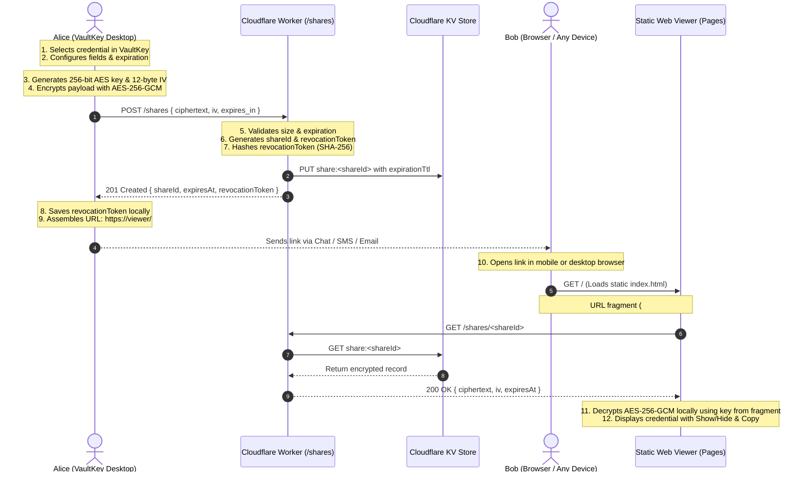

# VaultKey Cross-Device Password Sharing Guide

This document describes the secure, zero-knowledge cross-device password sharing architecture implemented in VaultKey, deployment instructions for Cloudflare Workers & Cloudflare Pages, and verification procedures.

---

## Architecture Overview



---

## Zero-Knowledge & Security Model

1. **Zero Plaintext Transmission**: Plaintext passwords, usernames, and notes never leave the local VaultKey desktop application.
2. **Fragment-Isolated Decryption Keys**: Decryption keys are stored strictly in the URL fragment (`#key=...`). RFC 3986 guarantees user agents do not send fragments in HTTP request headers.
3. **No Keys on Sharing Server**: Cloudflare Worker and Cloudflare KV never store or receive decryption keys or master passwords.
4. **Capability-Based Revocation**: Each share gets an unguessable 32-byte revocation token. The server stores only its SHA-256 hash. Revocation requires providing the token in the `X-Revocation-Token` header, verified in constant time.
5. **Authenticated Encryption (AES-256-GCM)**: Uses standard Web Crypto API with 12-byte unique initialization vectors per operation. Tampered ciphertexts or invalid tags immediately fail authentication.
6. **No External CDNs or Fonts**: The Web Viewer contains zero external scripts, Google Fonts, or trackers, preventing metadata leakage or cross-origin tracking.
7. **Offline-First Vault Integrity**: The desktop vault remains 100% offline. Local argon2id, PBKDF2, and Fernet vault operations require no internet connection.

---

## Deployment Instructions

### 1. Cloudflare Worker (Sharing API)

1. Open a terminal in `sharing-service/`.
2. Run `npm install`.
3. Run `npx wrangler login` to log in to your Cloudflare account.
4. Create the KV namespace:
   ```bash
   npx wrangler kv:namespace create SHARES_KV
   ```
5. Copy the generated KV `id` into `sharing-service/wrangler.toml`:
   ```toml
   [[kv_namespaces]]
   binding = "SHARES_KV"
   id = "<YOUR_KV_NAMESPACE_ID>"
   preview_id = "<YOUR_PREVIEW_KV_ID>"
   ```
6. Deploy the worker:
   ```bash
   npx wrangler deploy
   ```
   Note the deployed API URL (e.g., `https://vaultkey-share-api.your-subdomain.workers.dev`).

### 2. Web Viewer (Static Hosting)

Deploy the `share-viewer/` folder using Cloudflare Pages:
1. In Cloudflare Dashboard, go to **Workers & Pages > Pages**.
2. Select **Upload Assets**.
3. Name your project (e.g., `vaultkey-share`).
4. Upload `share-viewer/index.html`.
5. Note your public viewer URL (e.g., `https://vaultkey-share.pages.dev`).

### 3. Connect VaultKey Desktop Application

1. Open **VaultKey** desktop application.
2. Open **Settings** (`Ctrl+,`) and click **Cloud Sharing**.
3. Enter your **Sharing API Endpoint** and **Web Viewer URL**.
4. Click **Test Connection** to verify health check.
5. Click **Save Sharing Configuration**.

---

## Local Development & Testing

VaultKey includes automated unit and integration tests covering:
- Correct encryption/decryption
- Tampered payloads
- Expired link rejection
- Manual revocation
- Unauthorized revocation rejection
- API rate limiting & abuse prevention
- Zero-knowledge payload verification

Run the test suite:
```bash
node tests/test_sharing.js
```

Run Python server tests:
```bash
.venv\Scripts\python.exe -m unittest tests/test_server_sharing.py
```
